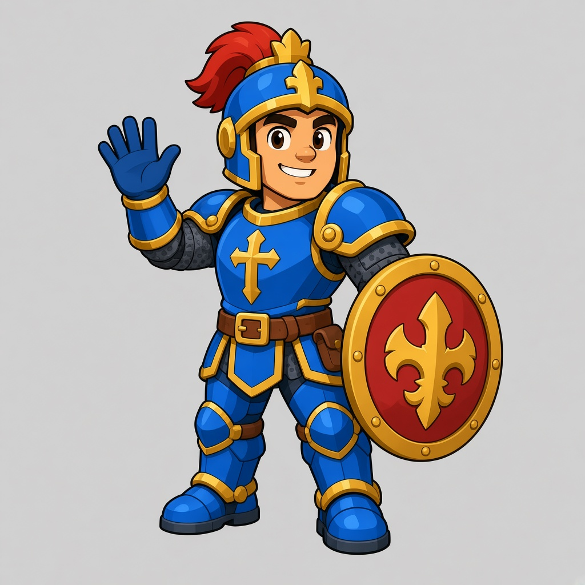

# Run 2026-11-25T09-48-22_the-same-knight-character-waving-hello-w

- Description: The same knight character waving hello with his free hand while holding his shield, friendly smile, front three-quarter view, as a game character portrait
- Reference: [reference.jpg](reference.jpg)
- Status: **approved**
- Attempts: 1 of 5 (threshold 80)
- Best attempt: 1 (score 85, attempt-1.jpg)

| Attempt | Score | Decision | Review mode | Issues | Image |
|---|---|---|---|---|---|
| 1 | 85 | APPROVED | self-review | 4 | [attempt-1.jpg](attempt-1.jpg) |

## Best attempt

Remaining issues:

- [minor/composition] Framed as a full-body figure rather than a tighter character-portrait crop; the face and waving hand occupy a relatively small part of the frame for a portrait
- [minor/requirement] The three-quarter turn is subtle; torso and feet are close to frontal, almost identical to the reference stance
- [minor/anatomy] No hand or grip is visible behind the shield, so the shield looks pinned to the forearm rather than actively held
- [minor/style] Lower body and leg pose are copied almost verbatim from the reference, making the new pose feel less natural and less dynamic
